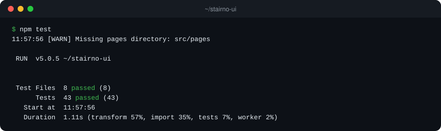
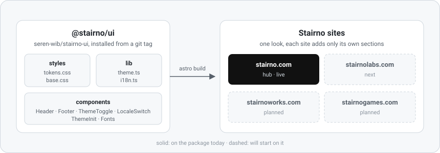

# stairno-ui

[**Quickstart**](#quickstart) | [**How it works**](#how-it-works) | [**Configuration**](#configuration) | [**Examples**](#examples) | [**FAQ**](#faq)

**stairno-ui** is the shared design package (`@stairno/ui`) for **every Stairno site**, so that **stairno.com, Labs, Works and Games look like one brand** without copying a stylesheet four times. It ships **design tokens, a base stylesheet and seven Astro components** (header, account menu, footer, theme toggle, locale switch, theme script, fonts) as plain source, **installed from a git tag**, with no build step and no npm publish. Node 22 or newer, Astro 7 as a peer dependency, nothing else.


[](https://github.com/seren-wib/stairno-ui/actions/workflows/ci.yml)
[](CHANGELOG.md)
[](https://nodejs.org/)
[](https://astro.build/)

[](#how-it-works)
[](#how-it-works)
[](CONTRIBUTING.md)

## Updates

- [2026/10/18] **v0.2.0, account menu.** `AccountMenu`: the round account button and profile card that the hub, the account center and every project site put in the header. Server-known user or a session read in the browser, keyboard and reduced-motion support, 89 tests. [Changelog](CHANGELOG.md)
- [2026/10/18] **v0.1.0, first release.** Tokens, base stylesheet, `Header`, `Footer`, `ThemeToggle`, `LocaleSwitch`, `ThemeInit`, `Fonts`, theme and locale helpers, 43 tests. Extracted from stairno.com with a pixel-identical build. [Changelog](CHANGELOG.md)

## Star History

<a href="https://star-history.com/#seren-wib/stairno-ui&Date">
  <picture>
    <source media="(prefers-color-scheme: dark)" srcset="https://api.star-history.com/svg?repos=seren-wib/stairno-ui&type=Date&theme=dark" />
    <source media="(prefers-color-scheme: light)" srcset="https://api.star-history.com/svg?repos=seren-wib/stairno-ui&type=Date" />
    
  </picture>
</a>

## Table of Contents

- [Why](#why)
- [Quickstart](#quickstart)
- [How it works](#how-it-works)
- [What a site gets](#what-a-site-gets)
- [Configuration](#configuration)
- [Examples](#examples)
- [Commands](#commands)
- [FAQ](#faq)
- [Contribution](#contribution)

## Why

Stairno runs four sites on four domains, each in its own repository. Without a shared package:

- The second site starts by copying `tokens.css`, the header and the footer from the first, and the copies drift the week after.
- A brand decision (one font, one monochrome palette, one header) has to be applied four times and checked four times.
- The theme script and the locale rules get rewritten per site, so a stored theme or a `/ko/` path behaves a little differently on each.

stairno-ui keeps all of that in one place:

- **One source for the look.** Colours, type, spacing, header, footer, toggle and switch live here. A site adds only its own sections.
- **Props in, markup out.** Components know no copy, no links and no project list. Every string comes from the site's own dictionaries.
- **Pinned, not floating.** Sites install a tag (`#v0.2.0`). A change here reaches a site only when that site bumps the tag in its own pull request.
- **Tested like the sites.** Unit tests for the helpers and stylesheets, Container API tests for every component, CI on each pull request.

## Quickstart

Steps 1 to 4 use the package in a site. Step 5 is for working on the package itself.

### Requirements

- **Node 22.22 or newer** and **npm** on your `PATH`
- git, and an Astro 7 project to use it from. For a blank one: `npm create astro@latest -- --template minimal`

### 1. Add the dependency

In the site repository:

```bash
npm install github:seren-wib/stairno-ui#v0.2.0
```

> [!IMPORTANT]
> Always pin a tag. `github:seren-wib/stairno-ui` without `#vX.Y.Z` installs whatever `main` is at install time, so two sites end up on different code and a later `npm install` changes the look without anyone bumping a version.

### 2. Put the head pieces in a layout

`src/layouts/Base.astro`:

```astro
---
import Fonts from '@stairno/ui/components/Fonts.astro';
import ThemeInit from '@stairno/ui/components/ThemeInit.astro';
import '@stairno/ui/base.css';

const { title } = Astro.props;
---

<html lang="en">
  <head>
    <meta charset="utf-8" />
    <meta name="viewport" content="width=device-width, initial-scale=1" />
    <ThemeInit />
    <title>{title}</title>
    <Fonts />
  </head>
  <body>
    <slot />
  </body>
</html>
```

`ThemeInit` goes before the title so the page never flashes the wrong theme. If the site has its own stylesheet, import it after `base.css` so it can build on the tokens.

### 3. Add the header and footer to a page

`src/pages/en/index.astro`:

```astro
---
import Header from '@stairno/ui/components/Header.astro';
import Footer from '@stairno/ui/components/Footer.astro';
import Base from '../../layouts/Base.astro';

const themeLabels = { light: 'Switch to light', dark: 'Switch to dark', toggle: 'Toggle theme' };
---

<Base title="Stairno Labs">
  <Header locale="en" brand="Stairno" switchLabel="한국어" themeLabels={themeLabels} />
  <main>
    <section class="hero">
      <div class="container">
        <h1>Stairno Labs</h1>
      </div>
    </section>
  </main>
  <Footer
    locale="en"
    brand="Stairno"
    links={{ heading: 'Projects', items: [{ href: 'https://stairno.com/en/', label: 'Hub' }] }}
    source={{ href: 'https://github.com/seren-wib/stairno-ui', label: 'Source' }}
    switchLabel="한국어"
  />
</Base>

<style>
  .hero {
    background: var(--night);
    color: var(--on-night);
    padding: calc(var(--header-height) + 4rem) 0 4rem;
  }
</style>
```

Pages live under a locale prefix (`/en/`, `/ko/`): the brand links to the locale home and the switch links to the same path in the other locale. The header is fixed and transparent over a night-coloured top section, so the first section of every page sits on `var(--night)` and leaves room for `--header-height`.

### 4. Build the site

```bash
npm run build
```

Astro compiles the package's `.astro`, `.ts` and `.css` files like the site's own. `dist/en/index.html` now has the header with the theme toggle, the footer, and links to `/ko/`; `npm run preview` serves it.

### 5. Work on the package

```bash
git clone https://github.com/seren-wib/stairno-ui.git
cd stairno-ui
npm ci
npm test
```

<p align="center">
  
</p>

## How it works

<p align="center">
  
</p>

The package is source only. `package.json` maps a handful of export paths to `.css`, `.ts` and `.astro` files; the consuming Astro project compiles them like its own files, including the component `<script>` and `<style>` blocks. There is no `dist/`, so a change is one commit, one tag and one bump in the site.

A few details:

- **Tokens never change with the site, only with the theme.** `tokens.css` declares brand constants (the night palette, the star, Pretendard) once and the light and dark sets on `html[data-theme]`. No media query decides the theme; the script does, once, before paint.
- **The inline theme script and `resolveTheme` are kept equal by a test.** The component test renders `ThemeInit`, runs the script with a fake `localStorage` and `matchMedia`, and compares the result with the TypeScript function for every case.
- **`Header` carries the scroll spy and the solid-on-scroll behaviour.** Any menu link to a `#section` gets `aria-current` when that section fills the view. Sites without an in-page menu pass no items and get the bar, the switch and the toggle.
- **The account menu is one component for three kinds of page.** A server that knows the user passes `user`; the hub, which has no server, passes `sessionUrl` and the browser asks the account API, staying signed out if the answer fails or takes more than 3 seconds. Either way the markup, the card and the keyboard behaviour are the same.
- **A site can decorate the labels.** `labelAttrs` on a menu item are spread onto the label span, which is how stairno.com draws the current item in dots without the package knowing about dots.
- **Shared classes, one owner.** `.site-header`, `.site-menu`, `.locale-switch`, `.site-footer`, `.footer-*`, `.container` and `.button` are styled here and nowhere else. A site that needs a different header is a brand decision, not a stylesheet override.

## What a site gets

<details>
<summary><b>Export map</b></summary>

| Import                                      | What it is                                                                                                                                                      |
| ------------------------------------------- | --------------------------------------------------------------------------------------------------------------------------------------------------------------- |
| `@stairno/ui`                               | `resolveTheme`, `nextTheme`, `isTheme`, `THEME_KEY`, `locales`, `localePath`, `alternateLocale`, `isLocale`, `defaultLocale` and the `Theme` and `Locale` types |
| `@stairno/ui/theme`                         | The theme helpers alone                                                                                                                                         |
| `@stairno/ui/i18n`                          | The locale helpers alone                                                                                                                                        |
| `@stairno/ui/tokens.css`                    | CSS variables only                                                                                                                                              |
| `@stairno/ui/base.css`                      | Tokens plus reset, type, container, header, locale switch, footer, button                                                                                       |
| `@stairno/ui/components/Header.astro`       | Fixed header: brand link, optional menu, `actions` slot, locale switch, theme toggle                                                                            |
| `@stairno/ui/components/AccountMenu.astro`  | Round account button for the header `actions` slot, with a profile card (account link, log out) or log in and sign up links                                     |
| `@stairno/ui/components/Footer.astro`       | Three columns: brand and tagline, a link list, source link and locale switch                                                                                    |
| `@stairno/ui/components/ThemeToggle.astro`  | Sun and moon button that flips `data-theme` and stores the choice                                                                                               |
| `@stairno/ui/components/LocaleSwitch.astro` | Link to the same path in the other locale                                                                                                                       |
| `@stairno/ui/components/ThemeInit.astro`    | The inline `<script>` that applies the theme before paint                                                                                                       |
| `@stairno/ui/components/Fonts.astro`        | Pretendard Variable preconnect and stylesheet links                                                                                                             |

</details>

<details>
<summary><b>Rendered header (stairno.com, Korean)</b></summary>

```html
<header class="site-header" data-sticky>
  <div class="container">
    <a class="brand" href="/ko/">Stairno</a>
    <nav class="site-nav">
      <ul class="site-menu" data-menu>
        <li>
          <a href="#projects"><span data-dot-text …>프로젝트</span></a>
        </li>
        <li>
          <a href="#news"><span data-dot-text …>소식</span></a>
        </li>
        <li>
          <a href="#contact"><span data-dot-text …>연락</span></a>
        </li>
      </ul>
      <a class="locale-switch" href="/en/" hreflang="en" lang="en" rel="alternate">English</a>
      <button type="button" class="theme-toggle" data-theme-toggle aria-label="테마 전환" …>
        …
      </button>
    </nav>
  </div>
</header>
```

</details>

## Configuration

Nothing is configured globally; every component takes props.

- **`Header`**: `locale`, `path`, `brand`, `items` (`{ href, label, labelAttrs? }[]`, optional), `switchLabel`, `themeLabels` (`{ light, dark, toggle }`). Slot `actions` renders between the menu and the locale switch, for the account menu.
- **`AccountMenu`**: `locale`, `labels` (`{ signedIn, signedOut, manage, signOut, signIn, signUp }`), `accountUrl` (account center overview), `signInUrl`, `signUpUrl`, `signOutUrl`, then one of `user` (`{ name, email }`, when the server knows who is signed in) or `sessionUrl` (read in the browser with credentials; expects the Better Auth get-session body `{ user: { name, email } }` or `null`), and `id` (card id, optional, generated by default). `signedIn` and `signedOut` are the button's `aria-label` in each state; the rest are visible text. Log out POSTs `{}` to `signOutUrl` with credentials and reloads the page.
- **`Footer`**: `locale`, `path`, `brand`, `tagline` (optional), `links` (`{ heading, items: { href, label }[] }`), `source` (`{ href, label }`), `switchLabel`, `year` (defaults to the build year).
- **`ThemeToggle`**: `labels` (`{ light, dark, toggle }`). `light` and `dark` name what the next click does and become the `aria-label`.
- **`LocaleSwitch`**: `locale` (the page's own), `path` (below the locale prefix), `label` (in the target language).
- **`ThemeInit`, `Fonts`**: no props.
- **`localStorage` key `theme`**: the only thing the package stores. Values are `light` or `dark`; anything else is ignored.

## Examples

<details>
<summary><b>A site header with the account menu, user known on the server</b></summary>

The account center and the project sites know the user from their own session and pass it in. `null` renders the signed-out card.

```astro
---
import AccountMenu from '@stairno/ui/components/AccountMenu.astro';
import Header from '@stairno/ui/components/Header.astro';
import { t, type Locale } from '../i18n';
const { locale } = Astro.props as { locale: Locale };
const copy = t(locale);
const user = Astro.locals.user; // { name, email } or null
---

<Header
  locale={locale}
  brand="Stairno"
  switchLabel={copy.nav.switchLocale}
  themeLabels={copy.nav.theme}
>
  <AccountMenu
    slot="actions"
    locale={locale}
    labels={copy.nav.account}
    user={user}
    accountUrl={`https://account.stairno.com/${locale}/`}
    signInUrl={`/${locale}/sign-in/`}
    signUpUrl={`https://account.stairno.com/${locale}/sign-up`}
    signOutUrl="/auth/sign-out"
  />
</Header>
```

`copy.nav.account` is the site's own dictionary entry, for example in English:

```ts
{
  signedIn: 'Account menu',
  signedOut: 'Log in or sign up',
  manage: 'Manage account',
  signOut: 'Log out',
  signIn: 'Log in',
  signUp: 'Sign up',
}
```

</details>

<details>
<summary><b>The account menu on a static page (the hub)</b></summary>

With no server to ask, the page renders signed out and the browser reads the session. The account API has to allow the page's origin with credentials on both URLs, and the page's CSP needs the API in `connect-src`.

```astro
<AccountMenu
  slot="actions"
  locale="en"
  labels={labels}
  sessionUrl="https://api.stairno.com/auth/get-session"
  signOutUrl="https://api.stairno.com/auth/sign-out"
  accountUrl="https://account.stairno.com/en/"
  signInUrl="https://account.stairno.com/en/sign-in?redirect=https://stairno.com/en/"
  signUpUrl="https://account.stairno.com/en/sign-up"
/>
```

</details>

<details>
<summary><b>Bump a site to a new version</b></summary>

In the site repository, on a feature branch:

```bash
npm install github:seren-wib/stairno-ui#v0.2.0
```

Commit `package.json` and `package-lock.json`, run the site's own tests, open a pull request. The screenshot comparison in that pull request is where a visual change gets noticed.

</details>

<details>
<summary><b>Work on the package and a site at the same time</b></summary>

Link the checkout instead of the tag while iterating:

```bash
npm install ../stairno-ui
```

Before committing the site, put the tag back with the first command above. A `file:` dependency never lands on `main`.

</details>

## Commands

| Command                | What it does                                        |
| ---------------------- | --------------------------------------------------- |
| `npm test`             | Unit and component tests (Vitest, Astro Container)  |
| `npm run test:watch`   | Same, in watch mode                                 |
| `npm run check`        | `astro check`: TypeScript across `.ts` and `.astro` |
| `npm run format`       | Prettier, write                                     |
| `npm run format:check` | Prettier, check only (what CI runs)                 |

## FAQ

### 1. `npm ci` fails with `Missing: @stairno/ui@github:seren-wib/stairno-ui#v0.2.0 from lock file`

The lockfile was written with a `file:` link or a different tag. Reinstall the pinned tag and commit the lockfile:

```bash
npm install github:seren-wib/stairno-ui#v0.2.0
```

### 2. `[WARN] Missing pages directory: src/pages` when running the tests

Expected. The package has no pages; Astro's Vite plugin notes that and carries on. The Container API renders components without a pages directory.

### 3. The header looks right but the theme toggle does nothing

`ThemeToggle` is a button plus a component `<script>`. It only runs when the component is rendered by Astro inside a page, not when its HTML is copied into a static file. Also check that `ThemeInit` sits in `<head>`; the toggle reads `data-theme` from `<html>` first.

### 4. My site overrides `.site-header` and the override stopped working

Overrides are not supported on purpose; every Stairno site shares one header. Change it here, bump the version, and update the sites.

### 5. The header text is invisible and the first heading hides under it

The header is fixed, transparent and white-on-night until the page scrolls past 24px, so on a page that starts with a white section it disappears and covers the top of the content. Start every page with a section on the night background and leave room for the header, as in [step 3](#3-add-the-header-and-footer-to-a-page):

```css
.hero {
  background: var(--night);
  color: var(--on-night);
  padding: calc(var(--header-height) + 4rem) 0 4rem;
}
```

## Contribution

Bug reports about a component rendering differently on one site than another, about the theme script, or about a token that drifts between light and dark are welcome, as are fixes with a failing test first. Branch, commit, merge and release rules are in [CONTRIBUTING.md](CONTRIBUTING.md).

If one shared header saves you from fixing four, a ⭐ helps other people find it.
